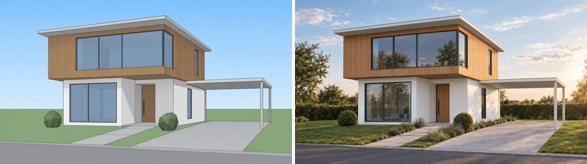
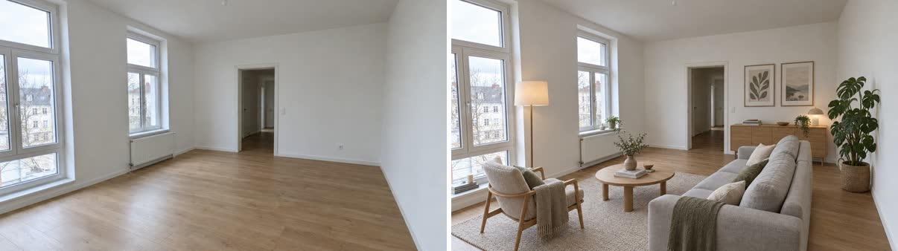
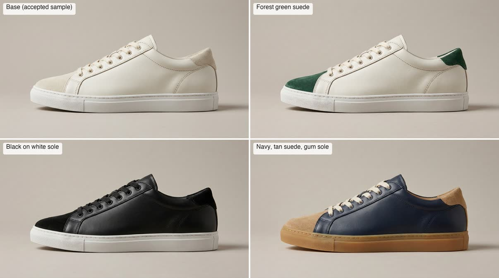
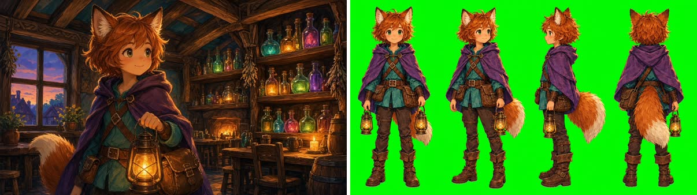
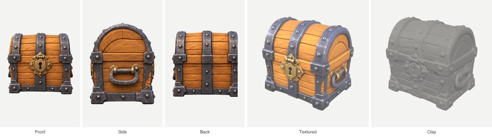

# Skills

Agent skills by Piotr Obidowski. Every skill is a plain `SKILL.md` folder in [`skills/`](skills/) following the [Agent Skills](https://agentskills.io/specification) format, so it works in Codex, Cursor, Claude Code, Gemini CLI, GitHub Copilot and any agent that reads `SKILL.md`.

## Visualizee skills

AI rendering for architects, interior designers, product and game designers, powered by [Visualizee](https://visualizee.ai/?utm_source=agent-skill&utm_medium=skill&utm_campaign=repo-readme). Each skill does one job, tells your agent what to ask you, how to word the request, which quality to pick and what it costs.

> **These skills need an active Visualizee subscription.** The skills are free and open source, but every render runs on your Visualizee account and spends its credits. See [Get a Visualizee subscription](#get-a-visualizee-subscription) below.

### architectural-render

Turn a SketchUp, Revit, ArchiCAD or Rhino screenshot, or a hand sketch, into a photoreal render. Massing, windows and camera stay exactly as designed; light, materials, sky and planting become real.



### interior-restyle

Stage an empty room or restyle a room photo: a new style, wall colour, flooring, cabinets or a single furniture swap. Walls, windows and camera stay as photographed.



### product-colorways

One product image in, consistent variants out: new colours and materials, clean studio packshots, transparent cutouts or lifestyle scenes, with the shape and details kept identical.



### game-asset-render

Props, icons, character turnaround sheets, UI elements and concept art that match your game's style, with real transparent PNGs for sprites and icons.



### render-video

Animate a still into a 3 to 30 second clip: an architectural push-in, a product turntable, a car reveal, a room flythrough. The skill always states the price before rendering.


### image-to-3d

One to four views of a single object become a textured GLB in 2 to 4 minutes, ready for Unity, Godot, Unreal, Blender or three.js.



## How it works

1. **You ask in plain words.** "Render this SketchUp screenshot at dusk" or "make a 3D model of this chest". The matching skill loads on its own, or you call it by name (`/visualizee:architectural-render` in Claude Code).
2. **The agent asks only what it needs.** Usually the image and what should change. Then it writes one sentence for Visualizee: what changes and what must stay exactly as it is.
3. **It picks a quality level and tells you the cost.** Base for quick drafts (80 credits per image), Pro for client work (150), Ultra for final shots (300). Video and 3D are always priced before anything renders.
4. **Visualizee renders.** Through the Visualizee MCP server (any plan, sign in once, no key) or the REST API with `VISUALIZEE_API_KEY` (Pro and Max, for scripts and batches). Slow renders are collected when they finish, never started twice.
5. **You get the file.** An image URL, an MP4 or a GLB, saved into your project if you like. Every render is also in your Visualizee workspace, where you can keep editing it with Vizzy. Failed renders are refunded automatically.

## Get a Visualizee subscription

1. **Pick a plan** at [visualizee.ai/pricing](https://visualizee.ai/pricing?utm_source=agent-skill&utm_medium=skill&utm_campaign=repo-readme):

   | Plan | Price | Credits a month | What the skills can do |
   |---|---|---|---|
   | Hobby | $20/mo | 7,500 | image skills and video up to 720p, through the MCP server |
   | Pro | $40/mo | 19,250 | everything: image skills, video up to 1080p, image-to-3D, REST API keys |
   | Max | $80/mo | 48,000 | everything, video up to 4K, larger batches |

   New accounts start on Free with 400 credits (about 5 images) to try the image skills before subscribing. Video, 3D and the REST API need a paid plan.

2. **Sign up and subscribe** at [visualizee.app](https://visualizee.app/?utm_source=agent-skill&utm_medium=skill&utm_campaign=repo-readme), then choose the plan on the Account page.

3. **Connect your agent** to the account, one of:
   - MCP server (all plans, no key): `claude mcp add --transport http visualizee https://visualizee.app/api/mcp`, then run `/mcp` in Claude Code and sign in with your Visualizee account.
   - REST API key (Pro and Max): on the Account page open **API**, create a key, and `export VISUALIZEE_API_KEY="vz_live_..."`. Keep it out of git.

Which plan each skill needs:

| Skill | Free trial | Hobby | Pro | Max |
|---|---|---|---|---|
| architectural-render, interior-restyle, product-colorways, game-asset-render | yes, a few images | yes | yes | yes |
| render-video | no | 720p | 1080p | 4K |
| image-to-3d | no | no | yes | yes |

## Install

**skills.sh**

```bash
npx skills add pobidowski/skills                              # choose skills from a list
npx skills add pobidowski/skills --skill architectural-render # a single skill
```

**Claude Code** (optional bundle, same skills)

```
/plugin marketplace add pobidowski/skills
/plugin install visualizee@pobidowski-skills
```

**Manual**

```bash
git clone https://github.com/pobidowski/skills
cp -r skills/skills/* ~/.claude/skills/   # or your agent's skills folder
```

Then connect your Visualizee account as in step 3 above.

Real brands are fine in prompts (a paint colour, a car, a sofa). Real people, song names and existing film, game or comic characters are not; Vizzy replaces or declines them. Test results for each skill are in [docs/visualizee-testing.md](docs/visualizee-testing.md).

## Repository layout

```
skills/<skill>/SKILL.md           one folder per skill, plus scripts/ when it needs a helper
assets/                           README images
shared/<group>/                   helpers copied into skills by scripts/sync-shared.sh
docs/                             test logs and notes
.claude-plugin/marketplace.json   optional Claude Code bundles that group skills
```

To add a skill: create `skills/<name>/SKILL.md` (the `name` in its frontmatter must match the folder). To bundle it for Claude Code, list it in a plugin entry's `skills` array in `.claude-plugin/marketplace.json`, then run `claude plugin validate .`.

## Licence

The skill text and scripts are MIT licensed, see [LICENSE](LICENSE). Example images are Visualizee renders, shared for illustration. Services a skill calls have their own terms, for Visualizee the [terms of service](https://visualizee.ai/terms-of-service).
