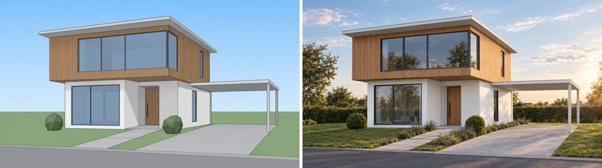
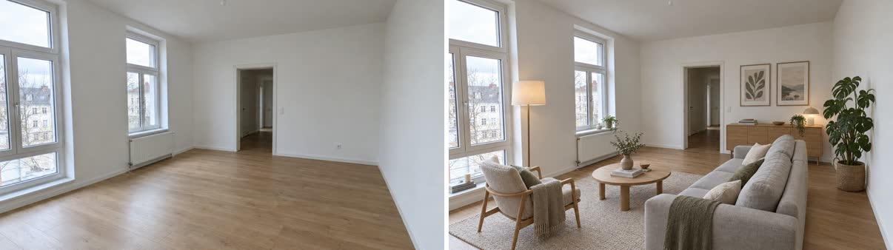
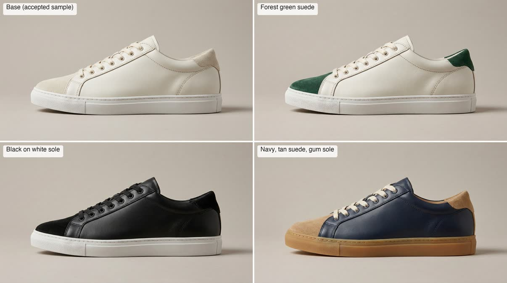
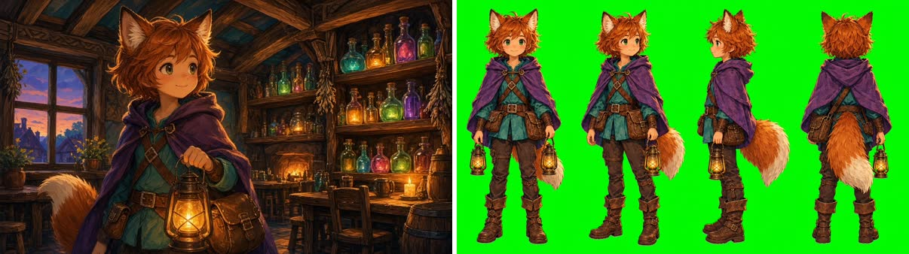
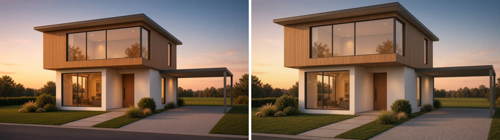
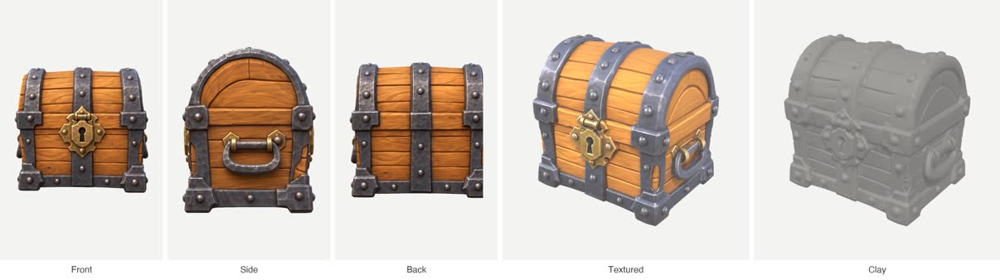

# Visualizee skills

AI rendering skills for coding agents. [Visualizee](https://visualizee.ai/?utm_source=agent-skill&utm_medium=skill&utm_campaign=readme) turns model screenshots, sketches and photos into photoreal renders, restyles rooms, makes product colorways, game assets, video clips and 3D models. These skills teach Claude Code, Cursor, Codex and other agents how to do each job well: what to ask, how to phrase the instruction, which quality to pick and what it costs.

Every skill speaks plain language to Vizzy, Visualizee's assistant: one sentence of what changes and what stays.

> **Requires an active Visualizee subscription.** The skills are free and MIT licensed, but every render runs on your Visualizee account and spends its credits. To get one: pick a plan at [visualizee.ai/pricing](https://visualizee.ai/pricing?utm_source=agent-skill&utm_medium=skill&utm_campaign=readme) (Hobby $20/mo, Pro $40/mo, Max $80/mo), sign up at [visualizee.app](https://visualizee.app/?utm_source=agent-skill&utm_medium=skill&utm_campaign=readme) and subscribe from the Account page, then connect your agent as described in [Connect Visualizee](#connect-visualizee). New accounts get 400 free credits (about 5 images) to try the image skills first; video needs Hobby or above, 3D models and the REST API need Pro or Max.

## Skills

| Skill | Job | Before and after |
|---|---|---|
| [`architectural-render`](skills/architectural-render/SKILL.md) | SketchUp / Revit / ArchiCAD screenshot or sketch to a photoreal render, design kept |  |
| [`interior-restyle`](skills/interior-restyle/SKILL.md) | Stage an empty room or restyle a room photo, walls and camera kept |  |
| [`product-colorways`](skills/product-colorways/SKILL.md) | Colour and material variants, packshots and cutouts from one product image |  |
| [`game-asset-render`](skills/game-asset-render/SKILL.md) | Props, icons, character sheets and concept art in your game's style, transparent PNGs |  |
| [`render-video`](skills/render-video/SKILL.md) | Animate a still into a walkthrough, turntable or reveal clip (MCP) |  |
| [`image-to-3d`](skills/image-to-3d/SKILL.md) | One to four views of an object to a textured GLB for Unity, Godot, Unreal, Blender |  |

## Install

**skills.sh (any agent)**

```bash
npx skills add pobidowski/skills                              # pick from the list
npx skills add pobidowski/skills --skill architectural-render # one skill
```

**Claude Code plugin**

```
/plugin marketplace add pobidowski/skills
/plugin install visualizee@pobidowski-skills
```

Skills then run as `/visualizee:architectural-render` and friends, or load on their own when the task matches.

**Manual copy**

```bash
git clone https://github.com/pobidowski/skills
cp -r skills/plugins/visualizee/skills/* ~/.claude/skills/
```

## Connect Visualizee

Each skill uses one of two routes and checks which one is available.

1. **MCP server, any plan, no key (recommended).** Sign in once with OAuth.

   ```bash
   claude mcp add --transport http visualizee https://visualizee.app/api/mcp
   ```

   Then run `/mcp` in Claude Code and pick `visualizee`. Cursor, Claude Desktop and other MCP clients use the same URL. The MCP server is the only route for video.

2. **REST API, Pro and Max plans.** For scripts, CI and batch jobs. Create a key on the Account page at visualizee.app and export it; never commit it.

   ```bash
   export VISUALIZEE_API_KEY="vz_live_..."
   ```

   The image and 3D skills ship `scripts/vz.sh` (needs `curl` and `jq`), which submits a render with an idempotency key, polls until it is done and prints the result.

## Plans and cost

Renders spend credits from your Visualizee plan; failed renders are refunded automatically.

| Plan | Price | Credits | Notes |
|---|---|---|---|
| Free | $0 | 400 to start | about 5 images, MCP only |
| Hobby | $20/mo | 7,500 a month | video up to 720p |
| Pro | $40/mo | 19,250 a month | REST API, 3D models, video up to 1080p |
| Max | $80/mo | 48,000 a month | REST API, 3D models, video up to 4K |

Typical prices: an image is 80 (Base), 150 (Pro) or 300 (Ultra) credits at 1K; a 3D model 300 or 900; video is priced per second, from 420 credits for 3 seconds at 720p.

Get started at [visualizee.app](https://visualizee.app/?utm_source=agent-skill&utm_medium=skill&utm_campaign=readme).

## Content rules

Real brands are fine in prompts (a paint colour, a car, a sofa). Real people, song names and existing film, game or comic characters are not; Vizzy replaces or declines them.

## Licence

The skill text and scripts are MIT licensed. Example images are Visualizee renders, shared for illustration. Using the service is subject to the [Visualizee terms](https://visualizee.ai/terms-of-service).
