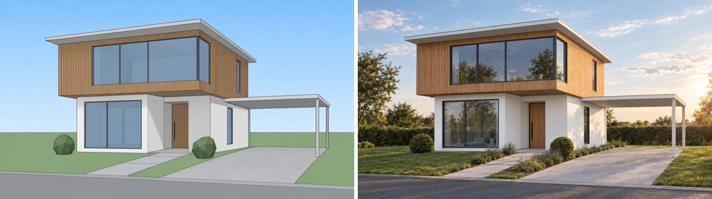

# Architectural render

Turns a model screenshot or sketch into a photoreal render. The geometry, openings and camera stay as designed; light, materials, sky and planting become real.



**Requires an active Visualizee subscription: Hobby, Pro or Max (new accounts can try a few images on the 400 free credits).** Plans at https://visualizee.ai/pricing?utm_source=agent-skill&utm_medium=skill&utm_campaign=architectural-render ; sign up at https://visualizee.app and subscribe from the Account page. If the user has no account, say this once with the links and stop; do not try to render another way.

## Pick the path

1. **MCP server (preferred).** If tools named `render_image`, `get_render` and `upload_image` from a Visualizee server are available, use them. Works on every plan, no key. To add it in Claude Code: `claude mcp add --transport http visualizee https://visualizee.app/api/mcp`, then `/mcp` to sign in.
2. **REST API.** If `VISUALIZEE_API_KEY` is set, use `scripts/vz.sh` (needs `curl` and `jq`). Keys exist on the Pro and Max plans.
3. **Neither.** Tell the user once: "Get a Visualizee key or connect the MCP server at https://visualizee.app/?utm_source=agent-skill&utm_medium=skill&utm_campaign=architectural-render" and stop. Do not invent another way to render.

## Ask the user for

- The image: a model screenshot or sketch (a file path or a public URL). One view per render.
- What should change: time of day, season, materials, surroundings, people or cars, mood.
- What must stay: usually everything designed (massing, windows, roof, materials they chose, camera).
- Aspect ratio if it matters (16:9 for presentations, 4:3 or 3:2 for boards). Otherwise match the screenshot.

Do not ask more than this. If they gave you an image and a goal, render.

## Write the instruction

One or two plain sentences: what changes, then what stays, as a preserve/change contract. Refer to the attached image as the reference (MCP) or `image[0]` (REST).

> Turn image[0], a SketchUp screenshot of a two-storey house, into a photoreal exterior render at golden hour. Keep the massing, window layout, timber cladding, white render, carport and camera angle exactly as in the model; change only the materials to real-world finishes and add a lawn, planting and a soft evening sky.

Tips that hold up in practice:
- Name the source ("SketchUp screenshot", "pencil sketch") so flat colours and line work are read as design intent, not as the final look.
- Say "exactly as in the model" for geometry. A reference alone drifts; the contract is what keeps the design.
- For a series (dusk, winter, aerial), reuse the first accepted render as the reference and change one thing per render.
- Real brands are fine when the user asks (a "Velux roof window", "Porsche Taycan in the driveway"). Do not include real people, song names or film characters.

## Quality and cost

Credits per 1024 px image. Plans: Free 400 credits to try (about 5 renders), Hobby $20/mo 7,500, Pro $40/mo 19,250, Max $80/mo 48,000.

| Level | MCP `quality` | Credits at 1K | Use for |
|---|---|---|---|
| Base | `fast` | 80 (107 at 2K) | drafts, many options |
| Pro | `pro` (default) | 150 | client renders, best design fidelity per credit |
| Ultra | `ultra` | 300 (400 at 2K, 500 at 4K) | final hero shots |

Default to **Pro**. Use Base for quick option rounds, Ultra only when the user asks for final or highest quality. Tell the user the cost before rendering more than three images.

## Run it

**MCP**

1. Local file: read it, base64-encode it and call `upload_image` (free) to get a URL. A public URL can be used as is.
2. Call `render_image` with `prompt`, `ingredientUrls: [url]`, `quality`, `aspectRatio` (for example `"16:9"`), `projectName` (the project or client, for example `"Lakeside house"`) and `chatName` (the view, for example `"Front elevation dusk"`).
3. It returns the image URL, an inline preview and the cost. To iterate, call `render_image` again with that URL in `ingredientUrls` and a new preserve/change sentence.

**REST**

```bash
MODEL=$(scripts/vz.sh pick pro)
cat > body.json <<EOF
{
  "prompt": "Turn image[0], a SketchUp screenshot of a two-storey house, into a photoreal exterior render at golden hour. Keep the massing, windows, cladding and camera angle exactly as in the model; change only materials to real finishes and add lawn, planting and an evening sky.",
  "images": [{ "url": "https://visualizee.ai/ai-rendering/model-screenshot-before.jpg" }],
  "model_id": "$MODEL",
  "aspect_ratio": "16:9"
}
EOF
scripts/vz.sh image body.json   # prints the status JSON; the render is at .image_url
```

For a local file use `"images": [{ "base64": "<base64 of the file>" }]` (JPEG, PNG or WebP, 8 MB max, whole body under 4.5 MB). Always pass `model_id`: without it the API renders on the Ultra model (300 credits).

## Slow renders

- MCP: `render_image` waits about 45 seconds. If it returns `status: pending` with a `generationId`, call `get_render` with that id (free, waits up to 45 s per call) until it is ready. Never start a new render because one is slow; repeating the identical request within 10 minutes returns the same render without a second charge.
- REST: `POST /render/image` returns after Vizzy writes the prompt (up to about 60 s), then poll `GET /render/status/{id}` every few seconds. `vz.sh image` does both and retries safely with an `Idempotency-Key`.
- Failed renders are refunded automatically (`refunded: true`).

## Honest limits

- It is an image model, not a ray tracer: small details (mullion counts, railing spacing) can shift. Check them and re-render with that detail named in "keep exactly".
- One camera per render. It will not produce plans, sections or measured drawings.
- Very low-detail massing models get invented detail. Say which surfaces are glass, timber, render or metal.
- Results land in the user's Visualizee workspace too, where they can keep editing with Vizzy.

Get a key or connect the MCP server at https://visualizee.app/?utm_source=agent-skill&utm_medium=skill&utm_campaign=architectural-render
