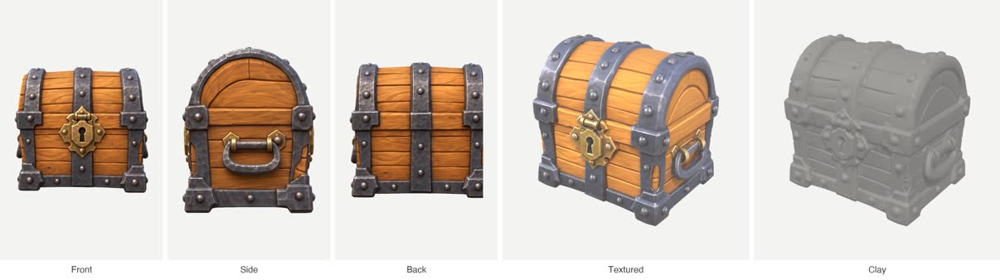

# Image to 3D

One to four views of one object in, a textured GLB out in 2 to 4 minutes. Static mesh, no rig.



## Pick the path

1. **MCP server (preferred).** Tools `render_3d_model`, `render_image`, `upload_image`, `get_render` from a Visualizee server. Claude Code: `claude mcp add --transport http visualizee https://visualizee.app/api/mcp`, then `/mcp` to sign in.
2. **REST API.** `VISUALIZEE_API_KEY` set: use `scripts/vz.sh 3d`.
3. **Neither, or a plan without 3D.** Tell the user once: "3D models need a Visualizee Pro ($40/mo) or Max ($80/mo) plan: https://visualizee.app/?utm_source=agent-skill&utm_medium=skill&utm_campaign=image-to-3d" and stop. `get_credits` says whether 3D is included.

## Ask the user for

- The image(s) of ONE object. Each must show the whole object on a plain background. Ideal: front, side and back at the same size and light.
- The level: Pro (most detail) or Base (cheaper, lighter files).
- Where the GLB should go in their project.

## Prepare the input

What makes a good model is the input:

- **One object, whole, plain background.** A room, scene, facade or UI screen is not one object. First render the single piece on its own with `render_image`: "Isolate the armchair from the reference on a plain light background, whole, centred, soft even light, nothing in front of it, square."
- **No image yet?** There is no text-to-3D. Render a concept with `render_image` first (one object, whole, centred, plain light background, square), get the user's OK, then build the model.
- **Better backs.** One view works, but the back is guessed. From an accepted render make extra views: "Show the same lantern from directly behind, same scale, same light, same plain background." Then tag them `front`, `left`, `back`, `right`.
- Transparent PNGs from the `game-asset-render` skill make clean inputs.

## Quality and cost

| Level | MCP `quality` | REST `quality` | Engine | Credits |
|---|---|---|---|---|
| Base | `fast` | `standard` | Tripo 3D | 300 |
| Pro | `pro` (default) | `pro` | Hunyuan 3D Pro, textures up to 4K | 900 |

Same price for one view or four. Pro plan ($40/mo) includes 19,250 credits, Max ($80/mo) 48,000. Tell the user the cost before rendering. Extra views made with `render_image` cost 80 to 150 each.

## Run it

**MCP**

1. `render_3d_model` with `images: [{ url, role: "front" }, { url, role: "back" }]` (roles on all images or none; one must be `front`), `quality`, `summary` (for example `"brass lantern prop, 2 views"`), and the `projectName` / `chatName` the source images came from.
2. It usually returns `status: pending` and a `generationId` after about 45 seconds. Call `get_render` with it (free) every call until it returns the GLB URL, a lighter GLB (2K textures, only for files over 8 MB) and a preview. Never start a new model because it is slow.
3. Download the GLB into the project, for example `curl -L -o Assets/Models/lantern.glb <url>`.

**REST**

```bash
cat > body.json <<'EOF'
{
  "images": [
    { "url": "https://example.com/chest-front.png", "role": "front" },
    { "url": "https://example.com/chest-side.png", "role": "left" },
    { "url": "https://example.com/chest-back.png", "role": "back" }
  ],
  "quality": "standard"
}
EOF
scripts/vz.sh 3d body.json | jq -r .model_3d.glb_url
```

The status JSON carries `type: "model_3d"`, `image_url` (a preview render) and `model_3d` with `glb_url`, `glb_light_url`, `glb_bytes` and `views`. `vz.sh 3d` polls every 15 seconds.

## Honest limits

- Static meshes only: no rig, no animation, no LODs, no separate parts.
- Topology is generated, not hand-modelled: fine for props and previews, retopologize hero assets.
- Thin parts (cables, chains, glass) and text come out soft or solid.
- Scale is arbitrary; set real-world size in the engine.
- Failed models refund automatically. Models are also saved in the Visualizee workspace, where they can be turned and checked in Clay view.

Get Pro or Max and a key, or connect the MCP server, at https://visualizee.app/?utm_source=agent-skill&utm_medium=skill&utm_campaign=image-to-3d
