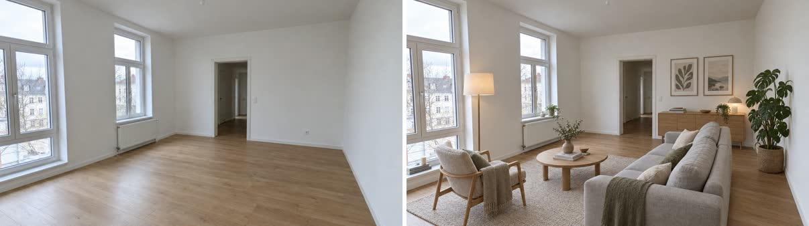

# Interior restyle

Takes a photo of a real room (or an interior model screenshot) and changes only what the user wants changed: furniture, style, colours, finishes. The room itself stays.



**Requires an active Visualizee subscription: Hobby, Pro or Max (new accounts can try a few images on the 400 free credits).** Plans at https://visualizee.ai/pricing?utm_source=agent-skill&utm_medium=skill&utm_campaign=interior-restyle ; sign up at https://visualizee.app and subscribe from the Account page. If the user has no account, say this once with the links and stop; do not try to render another way.

## Pick the path

1. **MCP server (preferred).** If tools named `render_image`, `get_render` and `upload_image` from a Visualizee server are available, use them. Every plan, no key. Claude Code: `claude mcp add --transport http visualizee https://visualizee.app/api/mcp`, then `/mcp` to sign in.
2. **REST API.** If `VISUALIZEE_API_KEY` is set, use `scripts/vz.sh` (needs `curl` and `jq`). Keys exist on the Pro and Max plans.
3. **Neither.** Tell the user once: "Get a Visualizee key or connect the MCP server at https://visualizee.app/?utm_source=agent-skill&utm_medium=skill&utm_campaign=interior-restyle" and stop.

## Ask the user for

- The room photo (file path or public URL), taken straight on, as wide as possible.
- The change: a style ("warm Scandinavian", "Japandi", "mid-century"), a single swap ("sage green walls", "herringbone oak floor", "navy shaker cabinets") or "furnish it as a ...".
- Optional reference images (up to 3 more): a sofa they like, a tile sample, a mood photo.

## Write the instruction

What changes, then what stays. Name every fixed element you can see.

> Furnish the empty room in the reference photo as a warm Scandinavian living room: light oak, a soft grey sofa, a wool rug, linen curtains and a few plants. Keep the walls, windows, doors, floor and camera angle exactly as in the photo; change only the furniture and decor.

Single swaps get the tightest contract:

> Change only the wall colour to Farrow & Ball Sulking Room Pink. Keep the furniture, floor, windows, lighting and camera exactly as in the photo.

With extra references, say what each one is for: "Use the sofa from image[1] and the rug from image[2]."

- One change per render gives the most faithful result; chain renders for several changes.
- Real paint, furniture and tile brands are fine. No real people, song names or film characters.

## Quality and cost

Credits per 1024 px image. Plans: Free 400 credits to try (about 5 renders), Hobby $20/mo 7,500, Pro $40/mo 19,250, Max $80/mo 48,000.

| Level | MCP `quality` | Credits at 1K | Use for |
|---|---|---|---|
| Base | `fast` | 80 | quick style options; may shift the camera or window layout |
| Pro | `pro` (default) | 150 | client-facing staging; keeps the room much more faithfully |
| Ultra | `ultra` | 300 | final, high-resolution hero images |

Default to **Pro** for anything shown to a client or buyer. Base is fine for "show me five styles quickly". Tell the user the cost before more than three renders.

## Run it

**MCP**

1. Local photo: base64 it and call `upload_image` (free) for a URL.
2. `render_image` with `prompt`, `ingredientUrls: [photoUrl, ...references]`, `quality`, `aspectRatio` matching the photo (for example `"4:3"` or `"16:9"`), `projectName` (the property or client) and `chatName` (the room, for example `"Living room"`).
3. To try another option, render again from the ORIGINAL photo URL, not from the previous result, so changes do not stack up.

**REST**

```bash
MODEL=$(scripts/vz.sh pick pro)
cat > body.json <<EOF
{
  "prompt": "Furnish image[0] as a warm Scandinavian living room with a soft grey sofa, wool rug and linen curtains. Keep the walls, windows, doors, floor and camera exactly as in the photo; change only furniture and decor.",
  "images": [{ "url": "https://visualizee.ai/ai-rendering/room-photo-before.jpg" }],
  "model_id": "$MODEL"
}
EOF
scripts/vz.sh image body.json
```

`aspect_ratio` defaults to `auto` (matches the photo). Ask for several styles in one call with `"max_renders": 3` and a prompt that says "three variations: Japandi, industrial, coastal". Always pass `model_id`; without it the API uses the Ultra model (300 credits).

## Slow renders

- MCP: if `render_image` returns `status: pending` with a `generationId`, call `get_render` with it (free) until ready. Do not start a new render; an identical request within 10 minutes returns the same one.
- REST: `vz.sh image` submits with an `Idempotency-Key` and polls `GET /render/status/{id}`.
- Failures refund automatically.

## Honest limits

- Base can reframe the room or move windows. If the user notices, re-render on Pro.
- Exact product replicas need a reference image of the product; a name alone gives a look-alike.
- It shows a design, not measurements. Furniture scale is plausible, not checked against the real room.
- Very dark or fisheye phone photos give weaker results; ask for a level, daylight shot.

Get a key or connect the MCP server at https://visualizee.app/?utm_source=agent-skill&utm_medium=skill&utm_campaign=interior-restyle
