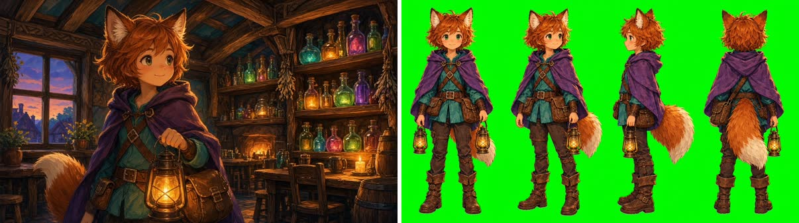

# Game asset render

Concept art, sprites, icons and character sheets that match the game's existing style, with true alpha when the asset needs it.



**Requires an active Visualizee subscription: Hobby, Pro or Max (new accounts can try a few images on the 400 free credits).** Plans at https://visualizee.ai/pricing?utm_source=agent-skill&utm_medium=skill&utm_campaign=game-asset-render ; sign up at https://visualizee.app and subscribe from the Account page. If the user has no account, say this once with the links and stop; do not try to render another way.

## Pick the path

1. **MCP server (preferred).** If tools named `render_image`, `get_render` and `upload_image` from a Visualizee server are available, use them. Every plan, no key. Claude Code: `claude mcp add --transport http visualizee https://visualizee.app/api/mcp`, then `/mcp` to sign in.
2. **REST API.** If `VISUALIZEE_API_KEY` is set, use `scripts/vz.sh` (needs `curl` and `jq`). Keys exist on the Pro and Max plans. Good for generating a whole icon set from a list in the repo.
3. **Neither.** Tell the user once: "Get a Visualizee key or connect the MCP server at https://visualizee.app/?utm_source=agent-skill&utm_medium=skill&utm_campaign=game-asset-render" and stop.

## Ask the user for

- A style reference: existing key art, a screenshot of the game, or a previous asset. Without one, ask for the style in words ("hand-painted fantasy", "low-poly flat shaded", "16-bit pixel art").
- The asset: what it is, the view (front, three-quarter, side, top-down) and the size it will be used at.
- Background: transparent (sprites, icons, items), a chroma green sheet (turnarounds), or a full scene (backgrounds, concept art).

In a game repo, look at existing assets first (for example `Assets/`, `res://`, `public/sprites/`) and offer one as the style reference.

## Write the instruction

What the asset is, what to match from the reference, and the framing.

> Game asset: a single stylized fantasy brass lantern with a glowing amber flame, the same hand-painted style as the fox adventurer's lantern in the reference. One object, whole, centred, three-quarter view, on a transparent background, no shadow on the ground, no text.

Character sheet from key art:

> Create a character turnaround sheet of the fox adventurer in the reference: front, three-quarter, side and back views, full body, same outfit, colours and proportions in every view, flat chroma green background, no text.

- For icon sets, keep one sentence and swap only the object, so the set stays consistent.
- Original characters only: do not recreate existing game, film or comic characters, and no real people. Real brands are fine on props when asked.

## Quality and cost

Credits per 1024 px image. Plans: Free 400 credits to try (about 5 renders), Hobby $20/mo 7,500, Pro $40/mo 19,250, Max $80/mo 48,000.

| Level | `quality` (MCP / REST) | Credits at 1K | Use for |
|---|---|---|---|
| Base | `fast` / `base` | 80 | concept exploration, no transparency |
| Pro | `pro` (default) | 150 | sprites, icons, items with real alpha |
| Ultra | `ultra` | 300 | key art, sheets with fine detail, 4K |

**Transparent PNGs need Pro or Ultra.** Base refuses `background: "transparent"` before charging.

## Run it

**MCP**

1. Local reference: base64 it and call `upload_image` (free).
2. `render_image` with `prompt`, `ingredientUrls: [styleRef]`, `quality: "pro"`, `background: "transparent"` for sprites and icons, `aspectRatio: "1:1"` for single assets or `"16:9"` for sheets, `projectName` (the game) and `chatName` (the asset group, for example `"Inventory icons"`).
3. Download the PNG from the returned URL into the project's asset folder. The inline preview shows transparency as black; the file itself has alpha.
4. Need it in 3D? Pass the transparent render to the `image-to-3d` skill.

**REST**

```bash
cat > body.json <<'EOF'
{
  "prompt": "Game asset: a single stylized brass lantern with an amber flame in the hand-painted style of image[0]. One object, whole, centred, three-quarter view, no ground shadow, no text.",
  "images": [{ "url": "https://visualizee.ai/try/game-character-sheet/rec-1-before.jpg" }],
  "quality": "pro",
  "aspect_ratio": "1:1",
  "background": "transparent"
}
EOF
scripts/vz.sh image body.json | jq -r .image_url | xargs curl -s -o lantern.png
```

`quality` `pro` and `ultra` both support `background: "transparent"`; `scripts/vz.sh models` lists each model's `quality` and `transparent_background`.

## Slow renders

- MCP: `status: pending` with a `generationId` means call `get_render` (free) until ready. Never re-submit; an identical call within 10 minutes is deduplicated.
- REST: `vz.sh image` polls the status endpoint and retries with one `Idempotency-Key`.
- Failures refund automatically.

## Honest limits

- No sprite-sheet animation frames or rigging. Frames rendered one by one drift; use a turnaround sheet for consistency.
- Pixel art is approximate: the model paints pixel-art style at high resolution. Downscale with nearest-neighbour and clean up.
- Exact tile seams and 9-slice UI borders need manual fixing.
- Text in UI renders can misspell; add text in the engine.

Get a key or connect the MCP server at https://visualizee.app/?utm_source=agent-skill&utm_medium=skill&utm_campaign=game-asset-render
