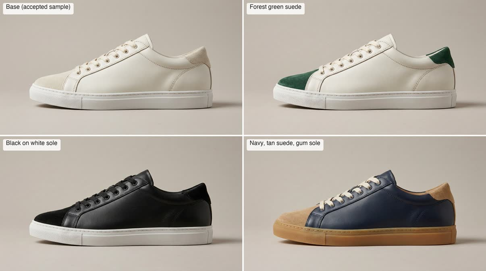

# Product colorways and packshots

One accepted product image in, consistent variants out: same product, same angle, new colour, material, background or scene.



**Requires an active Visualizee subscription: Hobby, Pro or Max (new accounts can try a few images on the 400 free credits).** Plans at https://visualizee.ai/pricing?utm_source=agent-skill&utm_medium=skill&utm_campaign=product-colorways ; sign up at https://visualizee.app and subscribe from the Account page. If the user has no account, say this once with the links and stop; do not try to render another way.

## Pick the path

1. **MCP server (preferred).** If tools named `render_image`, `get_render` and `upload_image` from a Visualizee server are available, use them. Every plan, no key. Claude Code: `claude mcp add --transport http visualizee https://visualizee.app/api/mcp`, then `/mcp` to sign in.
2. **REST API.** If `VISUALIZEE_API_KEY` is set, use `scripts/vz.sh` (needs `curl` and `jq`). Keys exist on the Pro and Max plans. Best for whole catalogues: tag each request with `"customer"` for per-client usage.
3. **Neither.** Tell the user once: "Get a Visualizee key or connect the MCP server at https://visualizee.app/?utm_source=agent-skill&utm_medium=skill&utm_campaign=product-colorways" and stop.

## Ask the user for

- The base image: one product, well lit, the angle they want to keep.
- The variants: a list of colour and material combinations (for example "burgundy suede upper, cream sole").
- Output: plain studio background, transparent PNG, or a scene ("on a concrete plinth", "in a sunlit hallway").
- Optional swatch or material photos as extra references.

## Write the instruction

One render per variant. Keep the sentence identical across the set except for the variant, so the series stays consistent.

> Render the sneaker as a clean studio packshot in a new colorway: burgundy suede upper with a cream sole and cream laces. Keep the shoe's shape, stitching, eyelets, side profile and camera angle exactly as in the reference; change only the colours and the upper material. Plain warm grey studio background, soft shadow, no text.

- If the reference holds several products, say which one ("only the white sneaker in the top-left panel").
- Logos and brand names already on the product are kept by the reference. Real brands are allowed in prompts (a "Pantone 19-1664 red", "Alcantara"). No real people, song names or film characters.
- For a swatch reference: "Apply the fabric from image[1] to the sofa in image[0]; keep the sofa's shape, seams and legs exactly."

## Quality and cost

Credits per 1024 px image. Plans: Free 400 credits to try (about 5 renders), Hobby $20/mo 7,500, Pro $40/mo 19,250, Max $80/mo 48,000.

| Level | `quality` (MCP / REST) | Credits at 1K | Use for |
|---|---|---|---|
| Base | `fast` / `base` | 80 | colour exploration, many variants |
| Pro | `pro` (default) | 150 | catalogue images, transparent cutouts |
| Ultra | `ultra` | 300 | hero images, fine textures, 4K |

Transparent backgrounds need Pro or Ultra. A set of 10 colorways on Base is 800 credits, on Pro 1,500. Say the total before starting a set.

## Run it

**MCP**

1. Local photo: base64 it and call `upload_image` (free).
2. For each variant, `render_image` with the same `ingredientUrls: [baseUrl]`, `quality`, `aspectRatio` (for example `"4:3"` or `"1:1"`), `projectName` (the product line) and `chatName` (the product, for example `"Court sneaker colorways"`).
3. For a cutout add `background: "transparent"` with quality `pro` or `ultra`; saying "transparent" only in the prompt renders a solid backdrop.
4. Always render variants from the BASE image, not from the previous variant.

**REST**

```bash
cat > body.json <<'EOF'
{
  "prompt": "Render the sneaker in image[0] as a studio packshot in burgundy suede with a cream sole and laces. Keep its shape, stitching, eyelets, profile and camera angle exactly; change only colours and the upper material. Plain warm grey background, soft shadow.",
  "images": [{ "url": "https://example.com/sneaker-white.jpg" }],
  "quality": "pro",
  "aspect_ratio": "4:3",
  "customer": "spring-catalogue"
}
EOF
scripts/vz.sh image body.json
```

For a transparent PNG add `"background": "transparent"` (with `quality` `pro` or `ultra`; Base answers `422 background_unsupported` before charging). For catalogue batches run up to 10 requests in parallel per key; an 11th answers `429 concurrency_limit` with `Retry-After`.

## Slow renders

- MCP: `status: pending` plus a `generationId` means call `get_render` (free) until ready. Never re-submit a slow render; an identical request within 10 minutes is deduplicated.
- REST: `vz.sh image` polls `GET /render/status/{id}` and retries with the same `Idempotency-Key`.
- Failures refund automatically.

## Honest limits

- Small text and fine print on labels can blur or change; keep packaging text large or composite it later.
- Exact colour matching to a physical sample is approximate. Give a Pantone or hex value and check it.
- Base may simplify stitching or hardware. Use Pro for catalogue output.
- One product per image works best; group shots need one reference per product.

Get a key or connect the MCP server at https://visualizee.app/?utm_source=agent-skill&utm_medium=skill&utm_campaign=product-colorways
