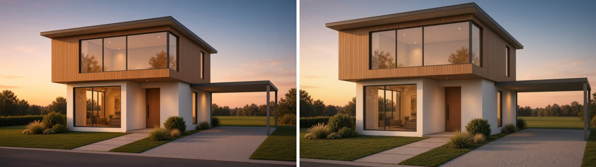

# Render video

Turns an accepted still into a 3 to 30 second clip with one deliberate camera move. Video costs far more than images, so this skill always states the price first.

**Requires an active Visualizee subscription: Hobby (720p), Pro (1080p) or Max (4K).** Plans at https://visualizee.ai/pricing?utm_source=agent-skill&utm_medium=skill&utm_campaign=render-video ; sign up at https://visualizee.app and subscribe from the Account page. If the user has no account, say this once with the links and stop; do not try to render another way.

## Pick the path

Video runs **only through the MCP server** (`render_video` and `get_render` tools from a Visualizee server). The REST API v1 renders images and 3D models only.

If those tools are missing, tell the user: "Connect the Visualizee MCP server to render video: `claude mcp add --transport http visualizee https://visualizee.app/api/mcp`, then `/mcp` to sign in. Account at https://visualizee.app/?utm_source=agent-skill&utm_medium=skill&utm_campaign=render-video" and stop.

## Ask the user for (one message)

- The still to animate (a render URL, or a local file to upload with `upload_image`).
- Duration in seconds, resolution, and vertical or horizontal (16:9 or 9:16).
- Audio on or off, and if on, what should be heard (room tone, wind, engine idle; music described by character, never by song or artist name).
- Then state the cost and wait for a yes. Skip the questions only if the user already answered them.

## Quality and cost

A clip costs **model credits per second x seconds x resolution multiplier**. Check `list_models` for current numbers; at the time of writing:

| Level | MCP `quality` | Model | Credits per second at 720p | 1080p | Notes |
|---|---|---|---|---|---|
| Base | `fast` | Gemini Omni Flash | 140 | x1.5 | 3-10 s, 16:9 or 9:16, no audio |
| Pro | `pro` (default) | Seedance 2.0 | 304 | x2.25 | 4-15 s, audio, up to 9 references |
| Ultra | `ultra` | Seedance 2.5 | 473 | x2.25 | 4-30 s, audio, up to 50 references |

Examples: 3 s Base 720p = 420 credits. 5 s Pro 1080p = about 3,420 credits. For comparison an image is 80 to 300.

Plans: Free 400 credits (not enough for a clip; the shortest Base clip is 420), Hobby $20/mo 7,500 at up to 720p, Pro $40/mo 19,250 at up to 1080p, Max $80/mo 48,000 at up to 4K. Call `get_credits` before an expensive clip.

## Write the prompt

Natural language, never JSON. For 4 to 8 seconds: a short brief plus a beat timeline.

1. Anchor on the image: "Open on @Image1, holding its exact composition, colours and architecture."
2. One camera move: slow push-in, gentle orbit, lateral dolly, static with parallax.
3. Two or three timed beats covering the whole clip: `[00:00-00:02] ...`.
4. Negatives inline: "avoid jitter, warping, and changes to the building geometry."
5. Audio on: describe sound as prose. Audio off: do not mention sound at all.

> Open on @Image1, holding its exact composition, colours and architecture: a modern two-storey house with timber cladding at golden hour. Slow, steady dolly forward toward the entrance, the house stays perfectly rigid and unchanged. [00:00-00:01] the camera begins a gentle push-in, grasses sway lightly in the breeze. [00:01-00:03] the push-in continues, warm interior lights glow a little brighter as the sky deepens. Avoid jitter, warping, and changes to the building geometry.

- Several images are references to the same subject, not first and last frames, unless the user explicitly asks for a transition.
- When the image carries the subject, describe it by what is visible ("the car in @Image1"); do not restate the brand, which can pull in an older model.
- Avoid the word "fast" and bare adjectives like "cinematic". No real people, song or artist names.

## Run it

1. `render_video` with `prompt`, `ingredientUrls: [stillUrl]`, `quality`, `duration`, `resolution` (`"720p"`, `"1080p"`), `aspectRatio`, and the same `projectName` and `chatName` the still lives in.
2. Set `audio` (default on) for Pro and Ultra. Base (Gemini Omni Flash) makes silent clips and ignores `audio`.
3. Video usually takes 2 to 8 minutes. The call returns `status: pending` with a `generationId` after about 45 seconds; call `get_render` with that id (free, waits up to 45 s per call) until it returns the MP4 URL. Tell the user it is rendering in between.
4. Never start a second render because the first is slow. It is already paid for; an identical request within 10 minutes returns the same clip.

## Honest limits

- No extend or continue: nothing goes past 30 seconds. Offer separate clips instead.
- Fine geometry (window mullions, wheel spokes) can wobble during fast moves; slow moves hold up better.
- No first-frame/last-frame keyframing; describe a transition in words if needed.
- Text and logos in motion can smear.
- Failed clips refund automatically.

Connect the MCP server or create an account at https://visualizee.app/?utm_source=agent-skill&utm_medium=skill&utm_campaign=render-video
